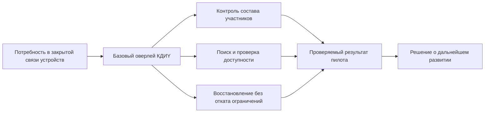
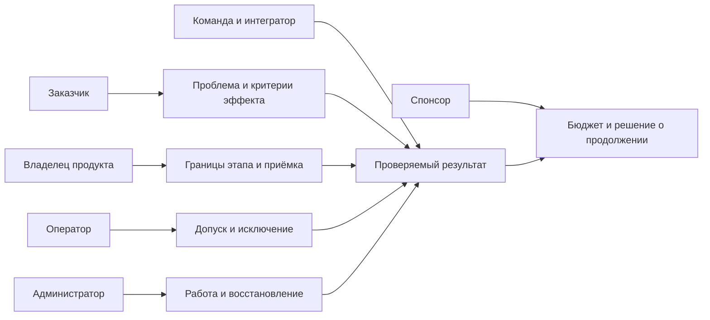
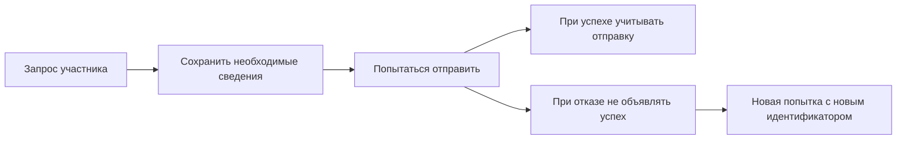
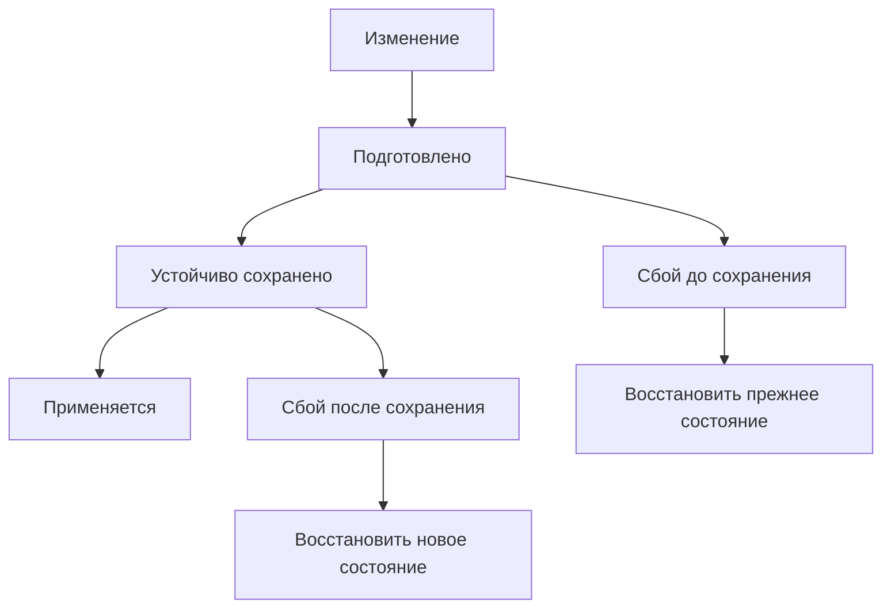
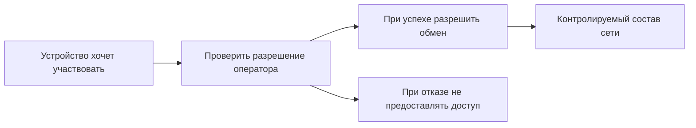
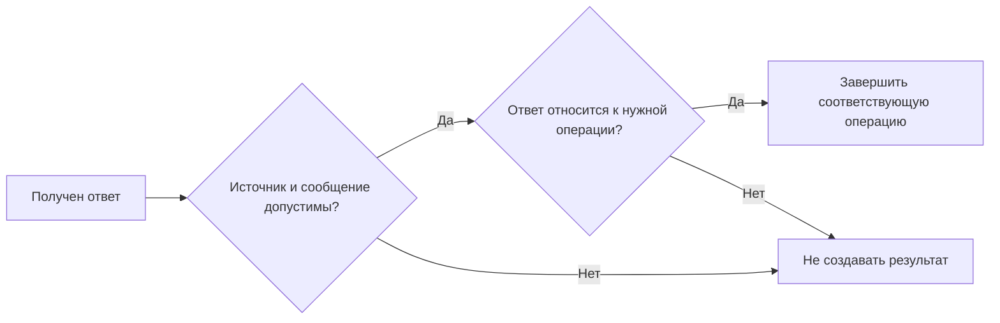
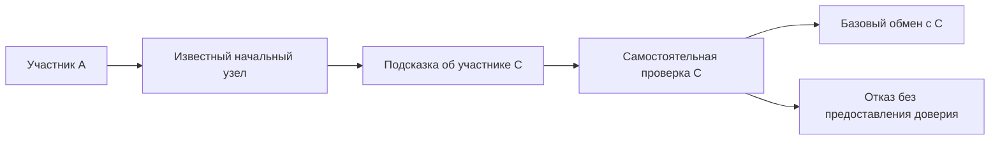

# SRS-КАБАНЧИКИ - КДИY - Кронверкский Децентрал имени Yimirs

## Software Requirements Specification - Спецификация требований к продукту

**Аудитория:** заказчики, владельцы продукта, руководители, инвесторы и операторы.
**Предмет:** бизнес-смысл базового закрытого P2P-оверлея.
**Статус:** рабочая спецификация. Польза, затраты и готовность подтверждаются пилотом и приёмкой.

## 1. Introduction (Введение)

### 1.1. Purpose (Цель)

Документ отвечает на вопросы: кому нужен КДИY, какую проблему он решает,
какой эффект должен дать и по каким результатам можно продолжать инвестиции.
Структура соответствует [основному SRS](SRS.md); подробности протокола изложены там.

Требования описываются через интересы заинтересованных сторон, наблюдаемые
результаты и условия приёмки. Доходность, экономия и коммерческая готовность
не считаются подтверждёнными без измерений и спроса.

### 1.2. Scope (Область применения)

КДИY создаёт закрытую сеть допущенных узлов: устройства проверяют друг друга,
находят участников и выполняют базовый защищённый обмен. Владелец сети
контролирует состав участников через выдачу и отзыв сертификатов.

Первая ценность продукта - управляемая основа связи между доверенными
устройствами. Это возможная база следующих продуктов, а не готовые C2,
файловое хранилище или сервис обновлений.

| Сейчас в фокусе              | Возможная следующая ценность                                   |
| ---------------------------- | -------------------------------------------------------------- |
| Управляемый допуск           | Подключение устройств и интеграторов                           |
| Поиск и проверка доступности | Основа распределённых приложений                               |
| Отзывы и восстановление      | Снижение риска возвращения исключённого сертификата после сбоя |
| Единые правила обмена        | Совместимость нескольких реализаций                            |

Обход NAT, ретрансляция, надёжная доставка, C2, хранение и обновления требуют
отдельных этапов и бюджета. До их приёмки нельзя обещать работу при любой
сетевой топологии, управление устройствами или доставку отключённому получателю.

### 1.3. Definitions, Acronyms and Abbreviations (Определения и сокращения)

| Термин                   | Для бизнес-аудитории                                                      |
| ------------------------ | ------------------------------------------------------------------------- |
| SRS                      | Что продукт обязан делать и как это принять                               |
| КДИY                     | Кронверкский Децентрал имени Yimirs                                       |
| Заинтересованная сторона | Участник, получающий пользу, несущий затраты или влияющий на решение      |
| Заказчик                 | Организация или команда, определяющая проблему и оплачивающая результат   |
| Владелец продукта        | Ответственный за приоритеты, границы и критерии успеха                    |
| Оператор                 | Участник, решающий, какие узлы допущены в сеть                            |
| Узел                     | Устройство или процесс, участвующий в сети                                |
| P2P-оверлей              | Логическая сеть взаимодействующих допущенных узлов                        |
| Сертификат               | Подписанное оператором разрешение узлу участвовать в сети                 |
| Отзыв                    | Аннулирование сертификата по его серийному номеру                         |
| Начальный узел           | Известная точка входа, помогающая найти участников                        |
| Устойчивое состояние     | Сведения, переживающие аварийное завершение                               |
| Пилот                    | Ограниченное внедрение для проверки сценариев, затрат и эффекта           |
| Приёмка                  | Решение о соответствии результата согласованным требованиям               |
| Эффект                   | Изменение затрат, риска, скорости работы или возможностей заказчика       |
| CAPEX                    | Разовые затраты на создание и внедрение                                   |
| OPEX                     | Регулярные затраты на эксплуатацию и сопровождение                        |
| TCO                      | Совокупная стоимость владения за выбранный период                         |
| ROI                      | Отношение чистого эффекта к вложениям по согласованной методике           |
| KPI                      | Измеримый показатель результата                                           |
| Гипотеза                 | Ожидаемая польза, которую ещё нужно проверить                             |
| (unspecified)            | Решение или показатель не зафиксированы; это не готовое обещание продукта |

### 1.4. References (Ссылки)

- [Основной SRS](SRS.md) - требования к поведению оверлея.
- [Обзор проекта](README.md) - направления и границы.
- [Расклад](РАСКЛАД.md) - компоненты и зависимости.
- [Ксива](КСИВА.md) - допуск, сертификаты и доверие.
- [Законтачка](ЗАКОНТАЧКА.md) - связь между узлами.
- [Ходка](ХОДКА.md) - последовательность проверяемых этапов.

Бизнес-версия переводит требования в пользу и условия решения о пилоте.
Она не расширяет технические гарантии основного SRS.

### 1.5. Overview (Обзор документа)

Раздел 2 описывает функции, участников, зависимости и ограничения.
Раздел 3 связывает требования с результатом для заказчика: удобством,
надёжностью, стоимостью эксплуатации, интерфейсами, лицензиями и приёмкой.

## 2. Overall Description (Общее описание)

### 2.1. Product Functions (Функционал продукта)

Система предоставляет четыре базовые возможности:

1. Контролировать, кто участвует в закрытой сети.
2. Находить и проверять доступность допущенных участников.
3. Отменять разрешение исключённого или скомпрометированного участника.
4. Восстанавливаться после сбоя без потери зафиксированных ограничений.

| Возможность                 | Польза                                                   | Что подтвердить                                           |
| --------------------------- | -------------------------------------------------------- | --------------------------------------------------------- |
| Управляемый допуск          | Знание адреса не даёт право участия                      | Недопущенный узел не получает прикладной доступ           |
| Поиск через начальный адрес | Возможное сокращение ручной настройки связей             | Найденный узел проверяется самостоятельно                 |
| Независимые запросы         | Параллельная работа без смешения ответов                 | Чужой ответ не завершает другую операцию                  |
| Устойчивые отзывы           | Исключённый сертификат не возвращается после перезапуска | Зафиксированный отзыв сохраняется                         |
| Сохранение идентификаторов  | Предсказуемый учёт операций после сбоя                   | Опубликованный запрос не получает повторный идентификатор |

### 2.2. User Characteristics (Описание пользователей и участников)

| Сторона                       | Интерес                                | Ответственность                           | Подтверждение пользы                      |
| ----------------------------- | -------------------------------------- | ----------------------------------------- | ----------------------------------------- |
| Заказчик                      | Решить задачу связи устройств          | Определить сценарий и ограничения         | Рабочий сценарий на его стенде            |
| Владелец продукта             | Получать полезные этапы                | Выбирать приоритеты и принимать результат | Выполненная приёмка этапа                 |
| Спонсор или инвестор          | Понимать расходы и условия продолжения | Утверждать бюджет                         | Отчёт пилота с затратами и рисками        |
| Оператор                      | Контролировать участие                 | Выдавать и отзывать сертификаты           | Проверенный допуск и исключение           |
| Администратор                 | Эксплуатировать устройства             | Настройка и восстановление                | Измеренные трудозатраты                   |
| Команда и интегратор          | Иметь стабильные границы               | Реализация и совместимость                | Общие сценарии и проверочные данные       |
| Ответственный за безопасность | Ограничить последствия компрометации   | Принять модель доверия                    | Отрицательные проверки и пределы гарантий |

#### 2.2.1. Оператор

Получает средство управления доступом. Решение о доверии остаётся его
ответственностью: распределённая связь не создаёт коллективного управления
полномочиями. Компрометация операторского ключа - существенный риск проекта.

#### 2.2.2. Администратор узла

Заинтересован в понятной установке и восстановлении. Сокращение ручных
трудозатрат является гипотезой и измеряется в пилоте.

#### 2.2.3. Допущенный узел

Представляет устройство или сервис заказчика. Участие даёт базовую связность,
а не автоматическое право выполнять команды, хранить пользовательские данные
или становиться ретранслятором.

#### 2.2.4. Недопущенный отправитель

Представляет источник нежелательного трафика. Для бизнеса важно, чтобы знание
адреса не превращалось в доступ и расходы на защиту учитывались в эксплуатации.

#### 2.2.5. Разработчик и участник приёмки

Обеспечивают проверяемый результат и объясняют его границы. Важен не объём
написанного кода, а выполненные требования, ограничения и воспроизводимость сценариев.

### 2.3. Assumptions and Dependencies (Влияющие факторы и зависимости)

#### 2.3.1. Криптографические библиотеки

Защищённый обмен зависит от подходящей библиотеки. Её лицензия и совместимость
с целевой сборкой влияют на стоимость и сроки. Выбор и цена сопровождения - **(unspecified)**.

#### 2.3.2. Издатель и локальный набор доверия

Заказчик должен определить, кто хранит ключ оператора, выдаёт допуски и отзывает
сертификаты. Распределение обязанностей в организации - **(unspecified)**.

#### 2.3.3. Хранилище и источник времени

Польза восстановления зависит от сохранности данных и правильного отсчёта сроков.
Стоимость инфраструктуры, резервирования и поддержки времени - **(unspecified)**.

#### 2.3.4. Сетевая доступность

Пилот требует согласованной среды с доступным IPv4/UDP. Первый профиль не решает
все проблемы NAT и межсетевых экранов. Новая среда проверяется до обещания заказчику.

### 2.4. Constraints (Ограничения)

1. Текущий продукт - базовый оверлей, а не готовая платформа управления устройствами.
2. Полномочиями управляет один оператор; устойчивость этой процедуры оценивается отдельно.
3. Пилот ограничен согласованной средой; работа при любом NAT не обещается.
4. Потеря связи не означает немедленное распространение отзывов по всей сети.
5. Неудачная отправка после сохранения может израсходовать идентификатор - это предусмотренное поведение.
6. Рынок, экономическая модель и схема продаж - **(unspecified)**.
7. Требования и пометки **(unspecified)** основного SRS сохраняют силу.

## 3. Specific Requirements (Спецификация требований)

### 3.1. Functionality (Функциональные требования)

Требования BIZ описывают результат для заинтересованных сторон.
Ссылки FR соответствуют группам основного SRS.

#### Идентичность и допуск

| Номер | ID     | Бизнес-требование                        | Приёмка                                                                  |
| ----- | ------ | ---------------------------------------- | ------------------------------------------------------------------------ |
| 3.1.1 | BIZ-01 | Владелец сети контролирует право участия | Проверенный допуск разрешает участие, неизвестный сертификат отклоняется |
| 3.1.2 | BIZ-02 | Начальный адрес не даёт полномочия       | Адрес без допуска не открывает прикладной обмен                          |

Основание: FR-ID-01 - FR-ID-07. Эффект - управляемая граница доступа.
Операторские инструменты и процедуры - **(unspecified)**.

#### Кадры и сообщения

| Номер | ID     | Бизнес-требование                                    | Приёмка                                              |
| ----- | ------ | ---------------------------------------------------- | ---------------------------------------------------- |
| 3.1.3 | BIZ-03 | Реализации одинаково понимают базовые сообщения      | Совпадают общие байтовые примеры и результаты отказа |
| 3.1.4 | BIZ-04 | Некорректный ввод не считается выполненной операцией | Неверное сообщение отклоняется                       |

Основание: FR-WIRE-01 - FR-WIRE-07. Возможное сокращение расходов интеграции
измеряется; оно не выводится из самого наличия общего формата.

#### Запросы и ответы

| Номер | ID     | Бизнес-требование                                         | Приёмка                                            |
| ----- | ------ | --------------------------------------------------------- | -------------------------------------------------- |
| 3.1.5 | BIZ-05 | Параллельные операции имеют независимые результаты        | Ответ на одну операцию не завершает другую         |
| 3.1.6 | BIZ-06 | Отказанная или просроченная операция не выглядит успешной | Нет ложного уведомления об отправке или завершении |

Основание: FR-REQ-01 - FR-REQ-10. Эффект - достоверный учёт операций
для следующих приложений.

#### Поиск узлов

| Номер | ID     | Бизнес-требование                              | Приёмка                                          |
| ----- | ------ | ---------------------------------------------- | ------------------------------------------------ |
| 3.1.7 | BIZ-07 | Участник находится через известную точку входа | Сценарий поиска работает на согласованном стенде |
| 3.1.8 | BIZ-08 | Найденный адрес проверяется                    | Ложная рекомендация не создаёт доверие           |

Основание: FR-DISC-01 - FR-DISC-05. Полный поиск и работа при изменении
состава большой сети - **(unspecified)**.

#### Сеансы и защита от повторов

| Номер  | ID     | Бизнес-требование                               | Приёмка                                                        |
| ------ | ------ | ----------------------------------------------- | -------------------------------------------------------------- |
| 3.1.9  | BIZ-09 | Повтор сообщения не создаёт повторный результат | Повторные и переставленные пакеты не обходят правила обработки |
| 3.1.10 | BIZ-10 | Сбой не возвращает старый сеанс                 | Для нового сеанса нужен корректный допуск                      |

Основание: FR-SESSION-01 - FR-SESSION-05. Надёжная доставка и правила
повторной передачи - самостоятельное расширение.

#### Отзывы сертификатов

| Номер  | ID     | Бизнес-требование                   | Приёмка                                                  |
| ------ | ------ | ----------------------------------- | -------------------------------------------------------- |
| 3.1.11 | BIZ-11 | Оператор может исключить сертификат | Принятый и сохранённый отзыв запрещает его использование |
| 3.1.12 | BIZ-12 | Перезапуск не отменяет исключение   | Отзыв сохраняется после восстановления                   |

Основание: FR-REV-01 - FR-REV-04. Сроки распространения, разделение сети
и процедуры компрометации - **(unspecified)**.

#### Устойчивое состояние

| Номер  | ID     | Бизнес-требование                                         | Приёмка                                                  |
| ------ | ------ | --------------------------------------------------------- | -------------------------------------------------------- |
| 3.1.13 | BIZ-13 | Восстановление сохраняет зафиксированные ограничения      | Не откатываются эпохи, отзывы и граница идентификаторов  |
| 3.1.14 | BIZ-14 | Ошибка после резервирования имеет предсказуемый результат | Нет ложной отправки; следующая попытка получает новый ID |

Основание: FR-STORE-01 - FR-STORE-07. Конкретное хранилище требует отдельной
приёмки, даже если правила восстановления определены.

### 3.2. Usability (Требования к удобству использования)

**3.2.1.** Оператор должен понимать, кому предоставлен допуск и какой отзыв принят.
**3.2.2.** Администратор должен различать ожидание, отказ, успешный обмен и восстановление.
**3.2.3.** Пилот должен измерять ручные действия и время подключения и восстановления.
**3.2.4.** Команды и эксплуатационные инструкции - **(unspecified)**; обязательная веб-панель не заявляется.

### 3.3. Reliability (Требования к надёжности и безопасности)

**3.3.1.** Важны сохранность решений о доверии и достоверность результатов операций.
**3.3.2.** Пилот проверяет неверный допуск, отзыв, повторы, отказы отправки и сбои сохранения.
**3.3.3.** Гарантии не распространяются автоматически на узлы, не получившие отзыв.
**3.3.4.** Показатели доступности и времени восстановления - **(unspecified)**, согласуются для конкретного применения.

### 3.4. Performance (Требования к производительности)

Показатели должны объяснять и качество работы, и цену результата.

| Показатель               | Измерение                                               | Зачем бизнесу                      |
| ------------------------ | ------------------------------------------------------- | ---------------------------------- |
| Время подключения        | От начала процедуры до допуска                          | Пригодность для процесса заказчика |
| Время поиска             | До результата или предусмотренного отказа               | Пригодность поиска                 |
| Восстановление           | До согласованного рабочего состояния                    | Эксплуатационная нагрузка          |
| Ручные действия          | Действия на подключение и типовой сбой                  | Возможное сокращение трудозатрат   |
| Стоимость активного узла | Затраты периода / согласованное число активных узлов    | Оценка расширения развёртывания    |
| Успешность сценария      | Успешные попытки / все попытки в фиксированных условиях | Соответствие условиям пилота       |

Пороги, стенд и период измерения - **(unspecified)**. Сравнение выполняется
с исходной практикой заказчика при одинаковых условиях и нагрузке.

**Гипотеза пользы:** предсказуемые подключение и восстановление могут снизить
ручные трудозатраты. Это подтверждается измерением, а не архитектурой P2P.

- TCO = создание и внедрение + инфраструктура + эксплуатация + сопровождение за выбранный период.
- Чистый эффект = согласованная измеренная польза - дополнительные затраты за тот же период.
- ROI рассчитывается по принятой заказчиком методике без двойного учёта затрат.
- Денежная оценка снижения риска требует отдельного обоснования.

Платное внедрение, сопровождение или лицензирование - коммерческие гипотезы
**(unspecified)**. Спрос, цена и маржа не установлены.

### 3.5. Design Constraints (Ограничения разработки)

**3.5.1.** Бюджет этапа должен соответствовать базовому оверлею; надстройки не становятся скрытым условием приёмки.
**3.5.2.** Выбор зависимостей учитывает сопровождение, совместимость и компетенции команды.
**3.5.3.** До пилота фиксируются сценарии, принимающая сторона, условия и критерии продолжения.
**3.5.4.** Бюджет, сроки и состав команды - **(unspecified)**; оцениваются по выбранной реализации.

### 3.6. Interfaces (Интерфейсы)

#### 3.6.1. User Interfaces (Пользовательские интерфейсы)

Нужен понятный способ выдать допуск, применить отзыв, запустить узел и получить
результат диагностики. Конкретные формы - **(unspecified)**; готовая панель не обещается.

#### 3.6.2. Hardware Interfaces (Аппаратные интерфейсы)

Устройства должны обеспечивать согласованную связь и сохранение данных.
Стоимость оборудования, памяти и носителей учитывается в TCO.
Конфигурация пилота - **(unspecified)**.

#### 3.6.3. Software Interfaces (Программные интерфейсы)

Интегратору нужен контракт подключения, доступности, поиска и обработки отказа.
Базовый оверлей не исполняет произвольные команды и не является хранилищем
пользовательских данных. API надстроек определяется отдельно.

#### 3.6.4. Communications Interfaces (Сетевые интерфейсы)

Первый профиль использует IPv4/UDP и короткие сообщения. Заказчик подтверждает,
что сеть пилота допускает обмен. Работа при любом NAT или фильтрации не обещается.
Устройства, адреса и сетевые правила - **(unspecified)**.

### 3.7. Licensing Requirements (Требования к лицензированию)

**3.7.1.** Заказчику должны быть понятны условия использования и ограничения зависимостей.
**3.7.2.** Лицензия продукта, права интегратора и договор сопровождения - **(unspecified)**.
Коммерческое предложение не заменяет проверку совместимости лицензий.

### 3.8. Прецеденты использования системы

#### UC-01. Найти и допустить узел через начальный адрес

**Стороны:** заказчик, администратор, оператор.
**Цель:** подключить участника без ручной настройки всех попарных связей.
**Предусловия:** согласованный стенд, допуск и начальный адрес.

1. Устройство входит в сеть по известному адресу.
2. Получает сведения о другом устройстве.
3. Самостоятельно проверяет его допуск.
4. Выполняет базовый обмен.

**Приёмка:** ложная подсказка не создаёт доверие; успешный сценарий воспроизводится.
**Эффект:** экономия настройки подтверждается измерением ручных действий.

#### UC-02. Проверить доступность при параллельных запросах

**Стороны:** администратор, интегратор, владелец продукта.
**Цель:** достоверный результат каждой операции.

1. Выполняются независимые запросы.
2. Приходит ответ на один из них.
3. Завершается только соответствующая операция.

**Приёмка:** поздний или чужой ответ не создаёт ложный успех.
**Эффект:** приложение связывает результат с исходным действием.

#### UC-03. Применить отзыв и восстановиться после сбоя

**Стороны:** оператор, безопасность, администратор.
**Цель:** исключённый сертификат не возвращается после перезапуска.

1. Оператор выпускает отзыв.
2. Узел проверяет и устойчиво сохраняет сведения.
3. Происходит сбой.
4. Восстановление сохраняет запрет.

**Приёмка:** сертификат не становится доступным после восстановления.
**Граница:** доставка отзыва всем участникам и её сроки - **(unspecified)**.

#### UC-04. Отправка отказана после резервирования идентификатора

**Стороны:** администратор, интегратор, заказчик.
**Цель:** отказ не превращается в неясную повторную операцию.

1. Запрос подготовлен, необходимые сведения сохранены.
2. Отправка не удалась.
3. Нет уведомления об успешной отправке.
4. Следующая попытка использует новый идентификатор.

**Приёмка:** нет ложного успеха и возврата израсходованного ID.
**Эффект:** предсказуемый отказ; автоматическое повторение не обещается.

### 3.9. Use-Case Diagrams (Диаграммы прецедентов)

#### Участники и функции

#### Отправка с устойчивым резервированием

#### Состояния устойчивого обновления

#### Установление защищённого сеанса и допуск

Детали согласования соединения и взаимной готовности - **(unspecified)**.

#### Проверка входящего прикладного сообщения

Схема иллюстрирует ответ. Запросы обрабатываются по правилам основного SRS.

#### Поиск узла через начальный адрес

### 3.10. Сводная таблица требований и приёмка

| Требования           | Чья польза                   | Признак результата                      | Условие решения                 |
| -------------------- | ---------------------------- | --------------------------------------- | ------------------------------- |
| BIZ-01, BIZ-02       | Оператор и безопасность      | Контролируемый доступ                   | Отрицательные сценарии пройдены |
| BIZ-03, BIZ-04       | Интегратор и заказчик        | Совместимый обмен                       | Проверочные данные согласованы  |
| BIZ-05, BIZ-06       | Администратор и приложение   | Независимые результаты                  | Нет смешения и ложного успеха   |
| BIZ-07, BIZ-08       | Заказчик и администратор     | Поиск и проверка                        | Сценарий воспроизводится        |
| BIZ-09, BIZ-10       | Безопасность и эксплуатация  | Повтор/сбой не возвращает старую работу | Отказы проверены                |
| BIZ-11, BIZ-12       | Оператор и безопасность      | Сохранённый отзыв не теряется           | Запрет остаётся после сбоя      |
| BIZ-13, BIZ-14       | Заказчик и интегратор        | Предсказуемое восстановление            | Ограничения не откатываются     |
| Удобство и экономика | Заказчик, владелец и спонсор | Измеренные трудозатраты и TCO           | Пороги (unspecified)            |

#### Приёмка определённого ядра

1. Заказчик согласовал сценарий, участников и условия стенда.
2. Допуск, поиск, ответы и отказ демонстрируют результаты основного SRS.
3. Повторы и сбои не создают ложную отправку или откат ограничений.
4. Предоставлены воспроизводимые проверки и перечень оставшихся ограничений.

#### Полная приёмка продукта (unspecified)

Для коммерческого внедрения определяются условия эксплуатации, интерфейсы,
стоимость владения, поддержка и незакрытые решения основного SRS.
Продолжение развития опирается на отчёт пилота.

| Решение       | Основание                                                                |
| ------------- | ------------------------------------------------------------------------ |
| Продолжить    | Есть полезный сценарий, проверки пройдены, затраты приемлемы             |
| Доработать    | Польза подтверждается, но конкретные критерии не закрыты                 |
| Приостановить | Потребность не подтверждена, среда несовместима или затраты не оправданы |

Отсутствие подтверждённого эффекта не подменяется обещанием надстроек.
Неудачный пилот уточняет границы применения и предотвращает необоснованные расходы.

#### Открытые решения (unspecified)

- Первый заказчик, целевой сегмент и исходный процесс для сравнения.
- Бюджет, команда, сроки и ответственные за приёмку.
- KPI, пороги и методика денежных оценок.
- Устройства, условия эксплуатации и сеть пилота.
- Коммерческая модель, цена, лицензия и поддержка.
- Отложенные технические механизмы основного SRS.
- Приоритет надстроек после принятой базы.
