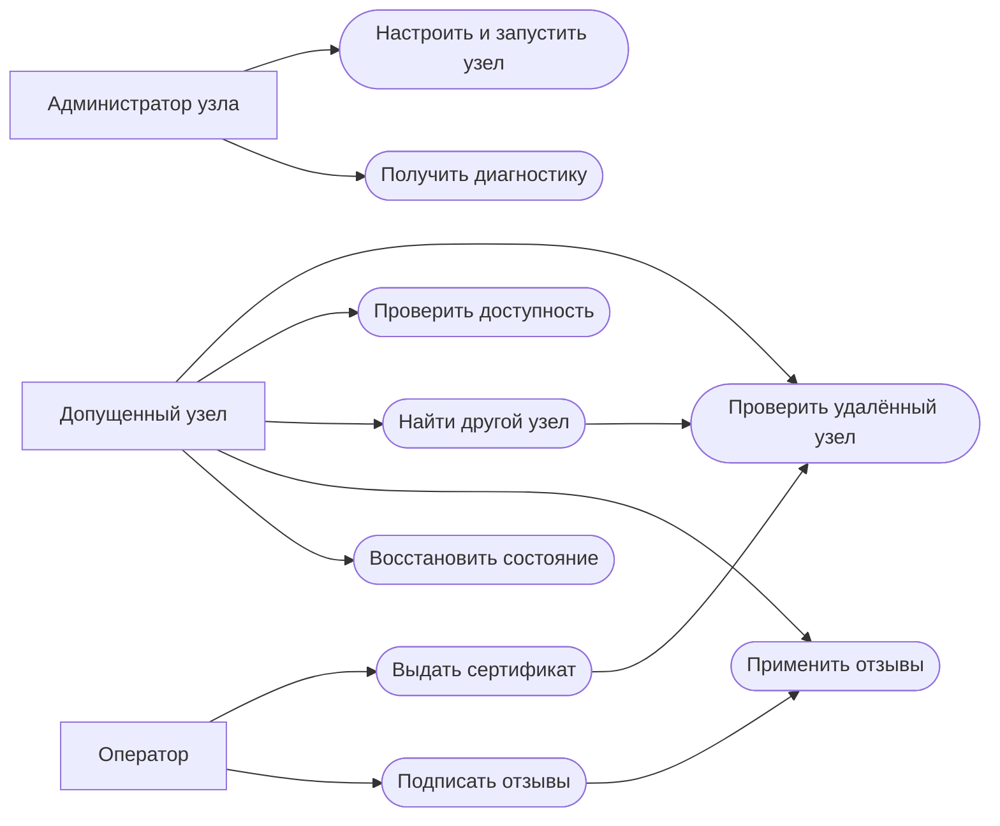
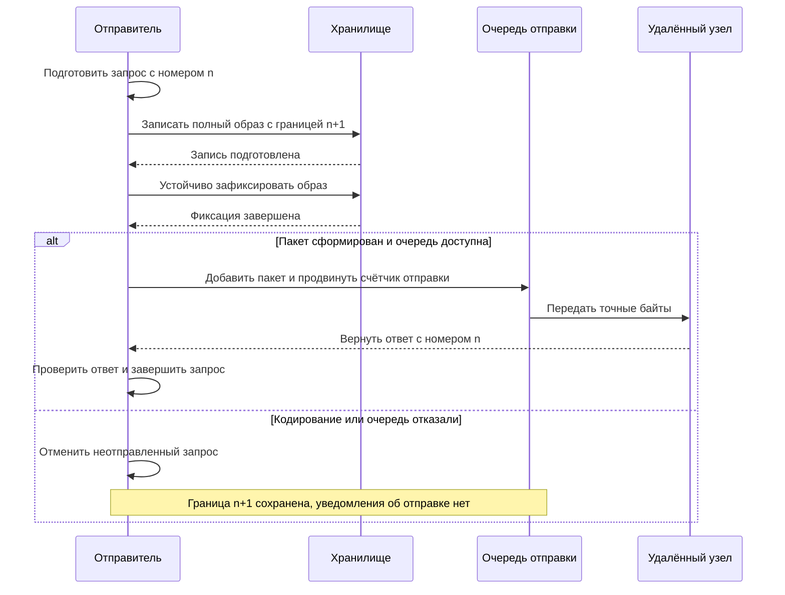
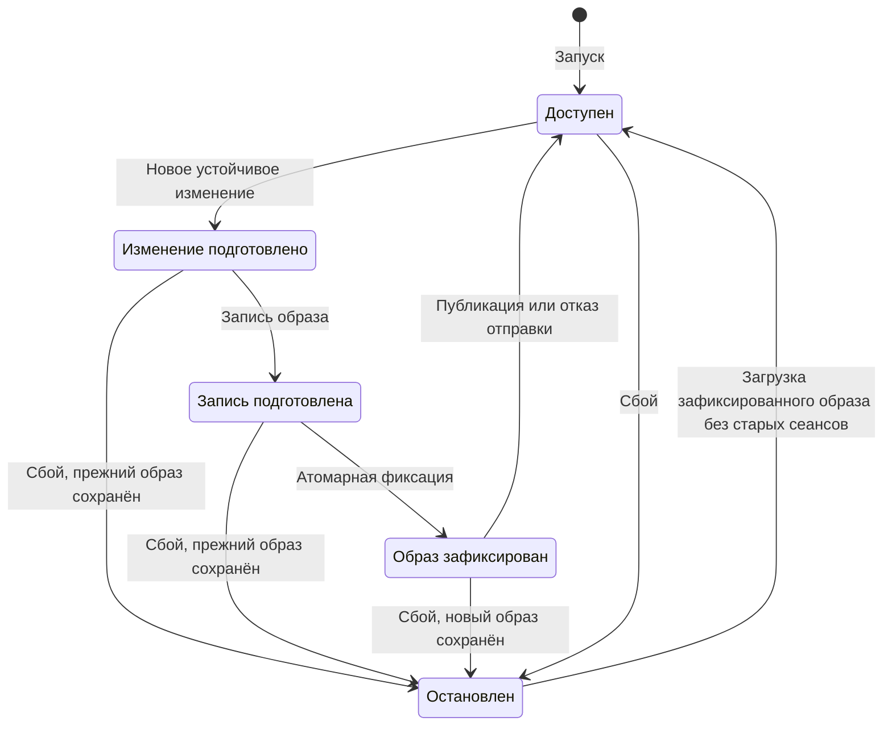
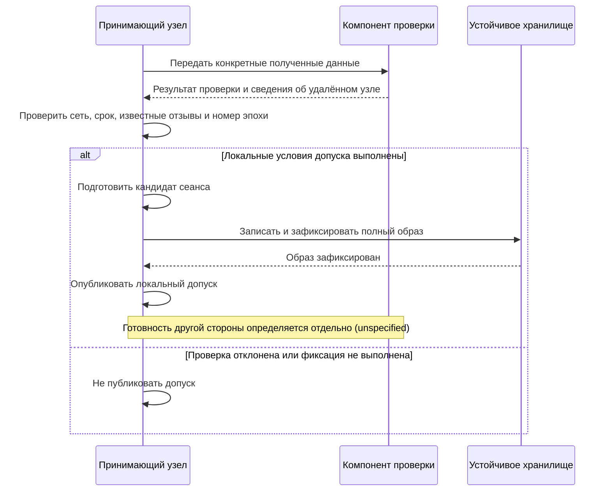
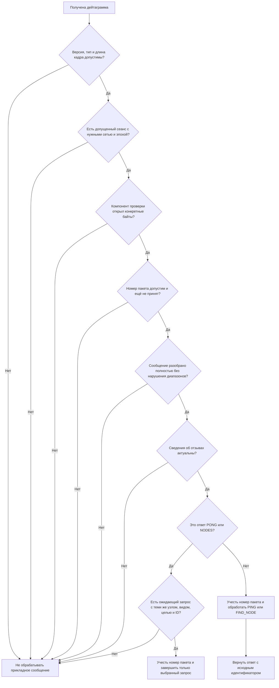
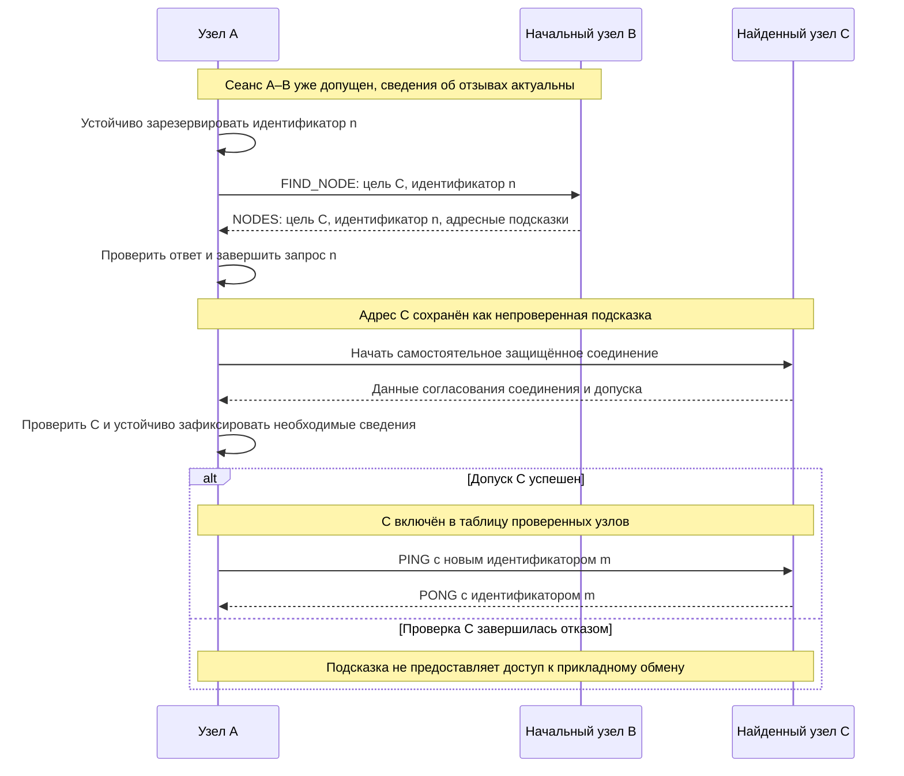

# SRS: КДИY ~ Кронверкский Децентрал имени Yimirs

## Software Requirements Specification ~ Спецификация требований к продукту

**Предмет:** базовый закрытый P2P-оверлей.

**Статус:** рабочая спецификация; готовность продукта определяется приёмкой.

## 1. Introduction (Введение)

### 1.1. Purpose (Цель)

Цель документа - описать функциональные и нефункциональные требования к
базовому оверлею «Кронверкский Децентрал имени Yimirs», определить ограничения, зависимости,
интерфейсы и основные сценарии использования.

Документ предназначен для проектировщиков, разработчиков, операторов и участников
приёмочных испытаний. Он задаёт требуемое поведение продукта независимо от
языка реализации, структуры исходного кода и способа проверки корректности.
Слово «должен» обозначает обязательное требование выбранного профиля.

В текущем профиле фиксируется уже определённое поведение ядра. Неуточнённые
механизмы сохраняются с пометкой **(unspecified)**: они требуют отдельного решения
и не задают готовый контракт реализации или итоговой приёмки. Если требование
определено частично, пометка относится только к явно перечисленной неопределённой
части. Предполагаемые результаты внешней проверки и устойчивого хранения
задаются как условия взаимодействия, без предписания ещё не выбранного механизма.

### 1.2. Scope (Область применения)

«Кронверкский Децентрал имени Yimirs» - закрытая сеть узлов, допущенных одним оператором.
Базовый оверлей позволяет узлам:

1. устанавливать защищённые соединения после проверки допуска;
2. проверять доступность других узлов;
3. находить узлы через начальные адреса и ответы участников сети;
4. принимать и сохранять подписанные сведения об отзывах сертификатов;
5. восстанавливаться после аварийного завершения без повторного использования
   опубликованных идентификаторов запросов и старых эпох сеансов.

В текущий профиль входят IPv4/UDP, Noise XX, PING/PONG, FIND_NODE/NODES,
защита от повторных пакетов и устойчивое хранение протокольного состояния.

Обход NAT, ретрансляторы, надёжная доставка с подтверждениями и повторной
передачей, упорядоченные потоки, C2, распределённое хранение и обновления агента
относятся к последующим расширениям. Сертификат участия в оверлее сам по себе
не предоставляет полномочия для этих надстроек.

### 1.3. Definitions, Acronyms and Abbreviations (Определения и сокращения)

| Термин                       | Определение                                                                                             |
| ---------------------------- | ------------------------------------------------------------------------------------------------------- |
| SRS                          | Спецификация требований к продукту - Software Requirements Specification                                |
| КДИY                         | Кронверкский Децентрал имени Yimirs                                                                     |
| ПО / ОС                      | Программное обеспечение / операционная система                                                          |
| P2P                          | Сеть, в которой узлы непосредственно взаимодействуют друг с другом                                      |
| Оверлей                      | Логическая сеть, работающая поверх существующей сетевой инфраструктуры                                  |
| Узел                         | Экземпляр ПО, владеющий ключами, идентичностью и состоянием оверлея                                     |
| Удалённый узел               | Другой участник соединения; его адрес не является подтверждением идентичности                           |
| NodeId                       | 32-байтовый идентификатор узла, полученный из его открытого ключа Ed25519                               |
| Оператор                     | Участник, принимающий решения о допуске и отзыве сертификатов                                           |
| Издатель сертификатов        | Подписант сертификатов и отзывов; в данном профиле - оператор                                           |
| Набор доверия                | Локальная конфигурация с идентификатором сети и доверенным открытым ключом издателя                     |
| Допуск узла                  | Предоставление доступа к сообщениям оверлея после проверки соединения и сертификата                     |
| Начальный узел               | Узел по заранее известному адресу, используемый для входа в сеть; также называется seed                 |
| Адресная подсказка           | Непроверенные NodeId и IPv4:port, полученные при поиске; не свидетельство допуска                       |
| Сеанс                        | Защищённое соединение между двумя узлами с согласованными ключами и идентификатором                     |
| Номер эпохи сеанса           | Номер поколения сеанса для удалённого узла. Он не является отметкой времени                             |
| Сохранённый номер эпохи      | Устойчиво зафиксированный номер, ограничивающий повторный допуск: новая эпоха должна быть строго больше |
| Идентичность сеанса          | Идентификатор удалённого узла, идентификатор сеанса и номер эпохи                                       |
| Идентификатор запроса        | Число, выделяемое отправителем для PING или FIND_NODE и повторяемое в ответе                            |
| Номер пакета                 | Счётчик пакетов в одном направлении конкретного сеанса; независим от идентификатора запроса             |
| Ожидающий запрос             | Отправленный запрос, для которого ещё не принят ответ, не выполнена отмена и не истёк срок ожидания     |
| Снимок отзывов               | Подписанные сведения о версии, сроке действия и серийных номерах отозванных сертификатов                |
| Актуальное состояние отзывов | Принятые сведения об отзывах, срок действия которых ещё не истёк                                        |
| Устойчивое состояние         | Данные, сохраняемые после аварийного завершения и восстановления процесса                               |
| Образ состояния              | Полный набор устойчивых протокольных данных, фиксируемый как одна единица                               |
| Атомарная фиксация           | Операция, после которой доступен либо прежний, либо новый полный образ; частичный образ недопустим      |
| Публикация                   | Момент, когда подготовленное состояние становится доступным или пакет допускается к отправке            |
| Защита от повторов           | Отказ от повторной обработки уже принятого номера пакета в пределах правил сеанса                       |
| Такт таймера                 | Единица отсчёта протокольных таймеров. Её длительность задаётся профилем эксплуатации                   |
| Проверочный вектор           | Известные входные данные, точные ожидаемые байты или ожидаемый отказ                                    |
| IPv4 / UDP / LAN             | Сетевой протокол / протокол дейтаграмм / локальная сеть                                                 |
| NAT                          | Преобразование сетевых адресов                                                                          |
| Noise XX                     | Схема согласования защищённого соединения с проверкой владения ключами                                  |
| Ed25519 / X25519             | Алгоритм цифровой подписи / алгоритм согласования ключей                                                |
| AEAD                         | Шифрование с проверкой целостности содержимого и связанных с ним данных                                 |
| XOR                          | Побитовое исключающее ИЛИ; используется для определения расстояния между NodeId                         |
| API / CLI / CI               | Программный интерфейс / интерфейс командной строки / непрерывная интеграция                             |
| C2                           | Управляющий контур; отдельная надстройка над оверлеем                                                   |

**(unspecified)** - поведение, параметр или механизм ещё не определён этим
профилем. Пометка не отменяет закреплённую часть требования и не означает,
что неопределённое решение можно выбрать неявно при реализации.

**Nonce** - значение, используемое криптографическим алгоритмом для различения
операций шифрования с одним ключом. Его построение и правила расходования
относятся к неуточнённому криптографическому механизму, а не определяются
одним правилом продвижения номера пакета.

Английские имена сообщений и полей в разделе 3.6 обозначают элементы протокола.
В описании требований используются соответствующие русские термины.

### 1.4. References (Ссылки)

- [Обзор проекта](README.md) - назначение и границы разработки.
- [Расклад](РАСКЛАД.md) - компоненты системы.
- [Законтачка](ЗАКОНТАЧКА.md) - соединения и сетевой транспорт.
- [Ксива](КСИВА.md) - ключи, сертификаты и модель доверия.
- [Малява](МАЛЯВА.md) - черновик двоичных форматов.
- [Ходка](ХОДКА.md) - этапы и условия приёмки.

Данный профиль предусматривает 48-байтовый заголовок с номером эпохи и передачу
целевого NodeId в NODES. Ранний 40-байтовый вариант из черновика формата должен
быть согласован с этими требованиями до фиксации версии протокола.

### 1.5. Overview (Обзор документа)

Раздел 2 описывает функции продукта, участников, зависимости и ограничения.
Раздел 3 содержит функциональные требования, требования к удобству использования,
надёжности и производительности, ограничения разработки, интерфейсы,
лицензирование, прецеденты использования, диаграммы и сводную таблицу требований.

## 2. Overall Description (Общее описание)

### 2.1. Product Functions (Функционал продукта)

Система создаёт закрытую сеть допущенных узлов поверх IPv4/UDP. Узлы устанавливают
защищённые сеансы, обмениваются короткими запросами проверки доступности и поиска,
проверяют ответы и применяют подписанные оператором отзывы сертификатов.

Найденный адрес остаётся подсказкой до самостоятельной проверки удалённого узла.
Система сохраняет сведения, необходимые для безопасного восстановления после
сбоя, и не откатывает уже зафиксированные номера эпох, отзывы и выделенные
идентификаторы запросов.

### 2.2. User Characteristics (Описание пользователей и участников)

#### 2.2.1. Оператор

- Принимает решения о допуске узлов и отзыве сертификатов.
- Подписывает сертификаты и снимки отзывов.
- Хранит закрытый ключ издателя вне обычных узлов.
- Настраивает начальные адреса и эксплуатационный профиль сети.

#### 2.2.2. Администратор узла

- Устанавливает и запускает ПО, передаёт узлу сертификат и набор доверия.
- Контролирует состояние соединений, запросов и восстановления.
- Обеспечивает сохранность ключей и устойчивых данных на устройстве.

#### 2.2.3. Допущенный узел

- Проверяет удалённые узлы перед обменом прикладными сообщениями.
- Отправляет PING и FIND_NODE, возвращает PONG и NODES.
- Применяет отзывы и восстанавливает устойчивое состояние после сбоя.
- Может быть начальным узлом без дополнительных полномочий издателя.

#### 2.2.4. Недопущенный отправитель

- Может знать сетевой адрес и отправлять произвольные дейтаграммы.
- Не получает доступ к прикладным сообщениям по факту знания адреса.
- Может создавать некорректные, повторные и чрезмерно большие входные данные.

#### 2.2.5. Разработчик и участник приёмки

- Реализует требования протокола и интерфейсов.
- Проверяет совместимость байтов, отрицательные сценарии, сбои и восстановление.
- Не должен подменять требования результатом одного успешного обмена.

### 2.3. Assumptions and Dependencies (Влияющие факторы и зависимости)

#### 2.3.1. Криптографические библиотеки

Система зависит от корректной реализации Noise XX, Ed25519, X25519 и AEAD.
Библиотеки должны поддерживать получение итогового хеша согласования соединения
и проверку фактического статического ключа удалённой стороны. Отсутствие этих
возможностей препятствует выполнению требований к допуску.

**(unspecified):** полная последовательность согласования соединения, форматы
криптографических свидетельств, выбор библиотеки и конкретная работа с ключами
и nonce. Для ядра входом служит результат проверки конкретных полученных данных.

#### 2.3.2. Издатель и локальный набор доверия

Открытый ключ издателя и идентификатор сети задаются локально. Предполагается,
что набор доверия установлен уполномоченным администратором. Компрометация
закрытого ключа издателя требует отдельной процедуры замены доверия.

#### 2.3.3. Хранилище и источник времени

Хранилище должно обеспечивать атомарную фиксацию полного образа и достоверно
сообщать об успешном устойчивом сохранении. Источник времени необходим для
проверки сроков сертификатов, актуальности отзывов и истечения запросов.
Восстановление процесса не должно само по себе продлевать эти сроки.

Зафиксированные фазы различают устойчиво сохранённый образ и временную запись.
**(unspecified):** неизвестный исход фиксации, повреждение носителя, физический
формат образа и механизм его проверки. Календарные часы, длительность такта,
пограничные события таймера и учёт времени простоя также **(unspecified)**.

#### 2.3.4. Сетевая доступность

UDP не гарантирует доставку, порядок или отсутствие повторов. Узлы могут
отключаться, а сеть - разделяться. Вредоносный допущенный узел может не отвечать
или сообщать ложные адреса. Завершение обмена допускается обещать только при
явно определённых условиях доступности и продвижения таймеров.

### 2.4. Constraints (Ограничения)

1. Первый профиль использует IPv4/UDP и собственный двоичный протокол.
2. Размер полной дейтаграммы ограничен 1200 байтами; фрагментация сообщений не входит в профиль.
3. В профиле действует один операторский издатель; бесшовная смена издателя и делегирование ролей отложены.
4. Соединение использует `Noise_XX_25519_ChaChaPoly_SHA256`; идентичность и допуск используют Ed25519.
5. Поиск определяет расположение узлов, но не предоставляет полномочия и не хранит произвольные значения.
6. Прямое соединение при любом NAT, доставка отключённому получателю и скрытие сетевых метаданных не обещаются.
7. Подтверждения, повторная передача и упорядоченные потоки требуют отдельного расширения протокола.
8. Численные ограничения локальных таблиц и таймеров приведены в разделе 3.6.4.

## 3. Specific Requirements (Спецификация требований)

### 3.1. Functionality (Функциональные требования)

Идентификаторы FR используются для связи требований с прецедентами и приёмкой.

Пометки в уточнениях ниже распространяются на соответствующие строки требований,
сценарии и схемы. Они не подменяют определённые правила дополнительными обещаниями.

#### Идентичность и допуск

| Номер | ID       | Требование                                                                                                                                                                                    |
| ----- | -------- | --------------------------------------------------------------------------------------------------------------------------------------------------------------------------------------------- |
| 3.1.1 | FR-ID-01 | Узел должен использовать локально заданные идентификатор сети, открытый ключ издателя, собственные ключи, сертификат и начальные адреса. Удалённая сторона не должна подменять набор доверия. |
| 3.1.2 | FR-ID-02 | NodeId должен вычисляться из открытого ключа Ed25519 с доменным разделением. Ключ X25519 для Noise должен быть независимым.                                                                   |
| 3.1.3 | FR-ID-03 | Закрытый ключ издателя должен храниться вне обычных узлов.                                                                                                                                    |
| 3.1.4 | FR-ID-04 | До допуска узел должен проверить сеть, подпись издателя, срок сертификата, NodeId, соответствие ключа Noise сертификату, подпись итоговой стенограммы и известные отзывы.                     |
| 3.1.5 | FR-ID-05 | Обработка прикладного сообщения должна проверять сеанс, номер эпохи, номер пакета и допустимость сообщения для текущего состояния.                                                            |
| 3.1.6 | FR-ID-06 | Начальный адрес и адресная подсказка не должны предоставлять доверие или полномочия.                                                                                                          |
| 3.1.7 | FR-ID-07 | При новом допуске узла номер эпохи сеанса должен быть строго больше устойчиво сохранённого номера эпохи для идентификатора этого удалённого узла.                                             |

Для FR-ID-01–04 закрепляется условие: сведения о проверенном узле предоставляются
доверенным проверяющим компонентом; они не могут заменяться адресной подсказкой
или признаком «проверено» из сетевого сообщения.
**(unspecified):** точная функция вычисления NodeId, управление ключами и настройка
набора доверия, форматы сертификата/AUTH, подписываемые данные и полный handshake.
Для FR-ID-07 определено сравнение с сохранённой границей; выделение и согласование
номеров эпох, создание идентификатора сеанса, одновременные соединения и взаимное
подтверждение готовности сторон - **(unspecified)**.

#### Кадры и сообщения

| Номер  | ID         | Требование                                                                                                                                                       |
| ------ | ---------- | ---------------------------------------------------------------------------------------------------------------------------------------------------------------- |
| 3.1.8  | FR-WIRE-01 | Узел должен принимать только поддерживаемые версии и типы кадров с корректной длиной не более 1200 байт.                                                         |
| 3.1.9  | FR-WIRE-02 | Сеть, сеанс, номер эпохи и номер пакета из заголовка должны соответствовать выбранному сеансу и быть защищены проверкой целостности вместе с содержимым.         |
| 3.1.10 | FR-WIRE-03 | Кодирование должно точно сохранять тип сообщения, идентификатор запроса, целевой узел и все поля адресных подсказок.                                             |
| 3.1.11 | FR-WIRE-04 | Разбор должен потреблять всё сообщение и проверять длины, диапазоны и количество записей. Неполные данные, лишние байты и превышения лимитов должны отклоняться. |
| 3.1.12 | FR-WIRE-05 | Получателю должны передаваться точные байты подготовленного пакета, без подмены его содержимого при отправке.                                                    |
| 3.1.13 | FR-WIRE-06 | Пакет должен соответствовать исходному сообщению, отправителю, получателю и контексту сеанса.                                                                    |
| 3.1.14 | FR-WIRE-07 | Дублирование пакета сетью не должно считаться выделением нового идентификатора запроса или повторной обработкой прикладного сообщения.                           |

В FR-WIRE-02 определена привязка заголовка к выбранной сети и сеансу, а открытых
байтов - к прикладному сообщению. **(unspecified):** конкретное шифрование,
построение nonce, его расходование при отказе очереди и состояние библиотеки Noise.

Отсутствие отправки не является определением безопасности повторного шифрования.

Для FR-WIRE-01 значения внешних типов допустимы в диапазоне 1–5; полное назначение
типов и правила кадров до допуска - **(unspecified)**. Макеты прикладных сообщений
в разделе 3.6.4 определяются отдельно от этих криптографических механизмов.

#### Запросы и ответы

| Номер  | ID        | Требование                                                                                                                                                                                     |
| ------ | --------- | ---------------------------------------------------------------------------------------------------------------------------------------------------------------------------------------------- |
| 3.1.15 | FR-REQ-01 | PING и FIND_NODE должны использовать общую таблицу ожидающих запросов и единое пространство идентификаторов на отправителе.                                                                    |
| 3.1.16 | FR-REQ-02 | Несколько запросов к одному узлу должны поддерживаться одновременно в пределах общего лимита 64 записей.                                                                                       |
| 3.1.17 | FR-REQ-03 | Ответ должен сопоставляться по проверенной идентичности отправителя, виду запроса, цели поиска при её наличии и идентификатору запроса.                                                        |
| 3.1.18 | FR-REQ-04 | PONG должен повторять идентификатор PING, а NODES - идентификатор и целевой NodeId исходного FIND_NODE.                                                                                        |
| 3.1.19 | FR-REQ-05 | Обработка PING/PONG и FIND_NODE/NODES должна требовать актуального состояния отзывов. При истечении его срока сообщения не должны обрабатываться как допустимые прикладные запросы или ответы. |
| 3.1.20 | FR-REQ-06 | Завершение и отмена должны удалять только выбранный идентификатор; другие корректные ожидающие запросы должны сохраняться.                                                                     |
| 3.1.21 | FR-REQ-07 | При создании запроса его срок ожидания должен быть установлен не позднее чем через 30 тактов таймера. При достижении срока запись должна удаляться.                                            |
| 3.1.22 | FR-REQ-08 | Ответ на от-енённый, завершённый или просроченный запрос должен игнорироваться и не должен повторно изменять прикладное состояние.                                                             |
| 3.1.23 | FR-REQ-09 | Повторная попытка должна получать новый идентификатор. Исчерпание пространства должно запрещать выделение новых идентификаторов без перехода счётчика через ноль.                              |
| 3.1.24 | FR-REQ-10 | Перезапуск и аварийное завершение должны отменять ожидающую работу без отката устойчиво зафиксированного счётчика идентификаторов.                                                             |

FR-REQ-05 использует строгое условие: текущее время меньше сохранённого срока
актуальности отзывов. FR-REQ-07 задаёт 30 единиц монотонного отсчёта и удаление
просроченной записи при продвижении времени. **(unspecified):** перевод в секунды,
очерёдность одновременно пришедших ответа/отмены/события таймера и физическое
время начала отправки относительно резервирования. Запрос становится видимым
вместе с успешным добавлением его пакета в очередь.

#### Поиск узлов

| Номер  | ID         | Требование                                                                                                                                             |
| ------ | ---------- | ------------------------------------------------------------------------------------------------------------------------------------------------------ |
| 3.1.25 | FR-DISC-01 | FIND_NODE должен возвращать до восьми ближайших по XOR известных проверенных узлов. Непроверенные кандидаты не должны рекламироваться как проверенные. |
| 3.1.26 | FR-DISC-02 | Адресные подсказки из NODES должны оставаться непроверенными до самостоятельного допуска найденного узла.                                              |
| 3.1.27 | FR-DISC-03 | Соединение с найденным узлом должно проходить полную самостоятельную проверку независимо от доверия к узлу, сообщившему его адрес.                     |
| 3.1.28 | FR-DISC-04 | Каждый этап поиска должен использовать ответ на собственный запрос. Ответ на другой параллельный запрос не должен подменять этот результат.            |
| 3.1.29 | FR-DISC-05 | Поиск должен иметь определённые условия завершения результатом или отказом, предел числа попыток и правила выбора следующих узлов.                     |

**FR-DISC-05 (unspecified):** полный алгоритм поиска, выбор следующих кандидатов,
число попыток и критерии завершения при изменении состава сети. В текущем профиле
определены отдельный запрос/ответ и последовательность успешных этапов при условии
доставки нужных ответов и самостоятельного допуска найденных узлов.
Поддержание таблицы, смена адресов и вытеснение записей - **(unspecified)**.
Доставка при неограниченных потерях или отключении всех доступных узлов не гарантируется.

#### Сеансы и защита от повторов

| Номер  | ID            | Требование                                                                                                                                                                  |
| ------ | ------------- | --------------------------------------------------------------------------------------------------------------------------------------------------------------------------- |
| 3.1.30 | FR-SESSION-01 | Номер исходящего пакета и ключ должны определяться выбранным действующим сеансом отправителя.                                                                               |
| 3.1.31 | FR-SESSION-02 | Продвижение счётчика отправленных пакетов должно происходить вместе с успешным добавлением пакета в очередь. Отказ кодирования или очереди не должен объявляться отправкой. |
| 3.1.32 | FR-SESSION-03 | Номера новых пакетов в одном направлении одного сеанса должны строго возрастать без повторного использования.                                                               |
| 3.1.33 | FR-SESSION-04 | Уже принятый номер пакета не должен повторно передаваться прикладному обработчику, в том числе при изменении порядка поступления.                                           |
| 3.1.34 | FR-SESSION-05 | После аварийного завершения старый сеанс не должен восстанавливаться из временных данных или незавершённого допуска.                                                        |

#### Отзывы сертификатов

| Номер  | ID        | Требование                                                                                                                                                  |
| ------ | --------- | ----------------------------------------------------------------------------------------------------------------------------------------------------------- |
| 3.1.35 | FR-REV-01 | Снимок отзывов должен применяться только после проверки подписи, сети, большей версии, действующего срока и допустимого количества записей.                 |
| 3.1.36 | FR-REV-02 | Принятая версия должна только возрастать, а отозванные серийные номера - накапливаться. Отсутствие прежнего номера в новом снимке не должно отменять отзыв. |
| 3.1.37 | FR-REV-03 | Устойчиво сохранённый отозванный серийный номер должен исключаться из доступных сеансов и подготовленных кандидатов, в том числе после восстановления.      |
| 3.1.38 | FR-REV-04 | Восстановление должно возвращать сохранённые версию, срок и накопленные отзывы без продления срока их актуальности.                                         |

FR-REV-01–04 определяют применение проверенного входа с большей версией,
накопление известных серийных номеров и их устойчивое сохранение. Подпись
предполагается проверенной внешним компонентом. **(unspecified):** байтовый формат
и подписываемый контекст, полный снимок или последовательные изменения,
восполнение пропущенных версий и путь получения обновлений. Большая версия
сама по себе не утверждает полноту неизвестных узлу отзывов.

#### Устойчивое состояние

| Номер  | ID          | Требование                                                                                                                                                            |
| ------ | ----------- | --------------------------------------------------------------------------------------------------------------------------------------------------------------------- |
| 3.1.39 | FR-STORE-01 | Сохранённые номера эпох, версия и срок отзывов, накопленные серийные номера и граница выделенных идентификаторов должны фиксироваться единым полным образом.          |
| 3.1.40 | FR-STORE-02 | Новое состояние или исходящее сообщение должны становиться доступными только после необходимой устойчивой фиксации.                                                   |
| 3.1.41 | FR-STORE-03 | Сбой до фиксации должен сохранять прежний образ и отменять подготовленную, но не опубликованную работу.                                                               |
| 3.1.42 | FR-STORE-04 | Сбой после фиксации должен сохранять новый образ, даже если публикация ещё не произошла. Зарезервированная эпоха или идентификатор остаются израсходованными.         |
| 3.1.43 | FR-STORE-05 | Отказ кодирования или полной очереди после фиксации идентификатора должен отменять неотправленный запрос без уведомления об отправке и без отката счётчика.           |
| 3.1.44 | FR-STORE-06 | Узел с незавершённой транзакцией устойчивого состояния должен приостановить обычную обработку до её завершения или отмены; остальные узлы должны продолжать работать. |
| 3.1.45 | FR-STORE-07 | Аварийное завершение и повторный запуск того же узла не должны обнулять его идентичность и устойчиво сохранённые сведения.                                            |

В FR-STORE-07 сохранение идентичности означает сохранение владельца протокольного
состояния при остановке; управление закрытыми ключами и их резервными копиями -
**(unspecified)**. Для FR-STORE-01–06 определён атомарный переход между полными
образами. Неизвестный исход записи, ошибки носителя, квоты, восстановление из
повреждённого файла и административный откат данных - **(unspecified)**.

### 3.2. Usability (Требования к удобству использования)

**(unspecified):** пользовательские интерфейсы, диагностические команды и набор
сообщений об ошибках. Ниже сохранены направления требований; текущий профиль
определяет успешное завершение и отсутствие ложного уведомления об отправке,
но не полный интерфейс администратора.

**3.2.1.** Система должна предоставлять понятные результаты запуска и диагностики:
неверная конфигурация, отказ допуска, отсутствие ответа, отмена, истечение срока
ожидания и ошибка устойчивого сохранения должны различаться.

**3.2.2.** Администратор должен иметь возможность определить идентификатор узла,
активные соединения, версию отзывов и состояние восстановления без доступа к закрытым ключам.

**3.2.3.** Уведомление о запросе должно содержать его идентификатор и конечный
результат. Неотправленный запрос не должен отображаться как успешно отправленный.

**3.2.4.** Процедуры установки доверия, запуска, отзыва и восстановления должны
быть описаны в эксплуатационной документации. Графический и браузерный интерфейсы
не требуются для базового профиля.

### 3.3. Reliability (Требования к надёжности и безопасности)

**3.3.1.** Потеря, повтор, задержка, изменение порядка пакетов и аварийное
завершение не должны приводить к нарушению правил допуска, повторной обработке
завершённого запроса или откату зафиксированных протокольных данных.

**3.3.2.** Хранилище должно восстанавливать либо предыдущий, либо новый полный
образ. Повреждённая или частичная запись не должна приниматься как корректный образ.

Атомарность и сохранение зафиксированного образа определены. Выявление повреждения
и действия при неизвестном результате фиксации - **(unspecified)**.

**3.3.3.** Восстановление не должно возвращать действующие сеансы и ожидающие
запросы из оперативной памяти завершившегося процесса.

**3.3.4.** Закрытые ключи и открытое содержимое защищённых сообщений не должны
попадать в обычные журналы, аргументы командной строки или служебные сетевые сведения.

**(unspecified):** управление секретами, журналирование и защита командной строки.

**3.3.5.** Подсказка, адрес отправителя и признак «проверено», переданный
удалённой стороной, не должны заменять собственную проверку полученных байтов.

**3.3.6.** После исчерпания ресурсов система должна возвращать определённый отказ.
Молчаливое обрезание списков или переход счётчиков через ноль недопустимы.

Определены отказы новой операции при заполненной таблице запросов, полной очереди
и исчерпанном ID, а также отказ сообщения с чрезмерным числом записей. Обычная
очистка и ограничение локальной таблицы непроверенных кандидатов не являются
ошибкой кодирования. Общий контракт нехватки памяти/диска - **(unspecified)**.

**3.3.7.** При недоступности сети или хранилища система должна сохранять
корректность устойчивых данных. Завершение зависимой операции не гарантируется.

Процент доступности, средний интервал между сбоями и допустимая длительность
восстановления устанавливаются после испытаний целевого развёртывания.

### 3.4. Performance (Требования к производительности)

Определены протокольные пределы размера кадра и отдельных таблиц. Измеренные
показатели, общий бюджет памяти, скорость обработки и масштаб развёртывания -
**(unspecified)**; пункты 3.4.3–3.4.5 сохраняют направления дальнейшей приёмки.

**3.4.1.** До обработки полей система должна проверить размер кадра и заявленное
количество записей. Превышение 1200 байт должно приводить к отказу.

**3.4.2.** Локальные таблицы, очередь отправки и состояния согласования соединений
должны иметь явные пределы. Протокольные лимиты должны соблюдаться под нагрузкой.

**3.4.3.** Приёмка должна измерять задержку PING, время поиска, скорость обработки
пакетов, потребление памяти и время восстановления на заданном стенде.

**3.4.4.** Целевые численные показатели и предельный масштаб сети должны быть
зафиксированы по результатам этих измерений. Стенд из трёх узлов не подтверждает
масштабируемость крупного развёртывания.

**3.4.5.** Ограничения памяти не должны обеспечиваться удалением ранее
зафиксированных отзывов или номеров эпох. Способ хранения растущих данных
требует отдельного проектного решения.

### 3.5. Design Constraints (Ограничения разработки)

**3.5.1.** Сетевой формат должен быть независимым от языка, операционной системы
и формата внутренних объектов реализации.

**3.5.2.** Первая планируемая реализация использует JDK 25 и GraalVM Static Native
Image. Выбор библиотеки Noise допускается после проверки криптографических
векторов и работоспособности статической сборки.

**(unspecified):** технологический выбор реализации и криптографических библиотек
не задаётся текущим протокольным ядром; пункт сохраняет проектный ориентир.

**3.5.3.** Криптографические примитивы должны использоваться согласно их назначению:
подпись не заменяет шифрование, а идентификатор сети не предоставляет полномочия.

**3.5.4.** Версии инструментов и зависимостей должны фиксироваться. Сборка,
проверочные векторы и приёмочные сценарии должны выполняться в CI.

**3.5.5.** Несовместимое изменение байтов требует явного решения о версии
протокола и обновления проверочных векторов.

**3.5.6.** Ограничения состояний соединений, частоты попыток допуска и устойчивого
хранения должны быть определены до эксплуатации открытых сетевых адресов.

**(unspecified):** конкретные квоты согласования соединений, частоты попыток и
устойчивого хранения. Они не следуют из лимитов действующих сеансов.

### 3.6. Interfaces (Интерфейсы)

#### 3.6.1. User Interfaces (Пользовательские интерфейсы)

**(unspecified)** - точный состав команд и диагностики.

Для базового профиля требуется операторское управление конфигурацией и
диагностика узла. Точный состав команд CLI и форматы диагностических экспортов
фиксируются отдельно. Веб-панель относится к последующей надстройке.

#### 3.6.2. Hardware Interfaces (Аппаратные интерфейсы)

**(unspecified)** - аппаратные требования и целевой стенд.

Устройство должно обеспечивать IPv4-связность, хранение ключей и устойчивого
состояния, а также источник времени. Специальные требования к аппаратным
модулям защиты ключей не установлены. Ресурсные требования задаются для целевого стенда.

#### 3.6.3. Software Interfaces (Программные интерфейсы)

| Компонент                    | Требование к взаимодействию                                                                                  |
| ---------------------------- | ------------------------------------------------------------------------------------------------------------ |
| Криптографическая библиотека | Согласование ключей, проверка подписей, расшифрование с проверкой целостности и привязкой заголовка к сеансу |
| Проверка допуска             | Проверка конкретного сертификата и данных соединения перед созданием доступного сеанса                       |
| Кодирование сообщений        | Точное преобразование полей в байты, проверка диапазонов и полное потребление сообщения при разборе          |
| Устойчивое хранилище         | Атомарная фиксация полного образа и сохранение зафиксированного результата после сбоя                        |
| Часы и таймеры               | Проверка сроков и монотонное продвижение отсчёта ожидания запросов                                           |
| Диагностика                  | Различение подготовки, фиксации, отправки, отказа и восстановления без раскрытия секретов                    |

Система не предписывает конкретную БД или имена классов для этих интерфейсов.

#### 3.6.4. Communications Interfaces (Сетевые интерфейсы)

Транспорт - IPv4/UDP. Все многобайтовые целые числа передаются без знака,
старшим байтом вперёд. Длина полной дейтаграммы - не более 1200 байт.

| Поле заголовка   | Размер  | Назначение                                 |
| ---------------- | ------- | ------------------------------------------ |
| `magic`          | 4 байта | Маркер `D777`                              |
| `version`        | 1 байт  | Версия внешнего кадра; текущий профиль - 1 |
| `kind`           | 1 байт  | Тип внешнего кадра                         |
| `network`        | 16 байт | Идентификатор логической сети              |
| `session`        | 8 байт  | Идентификатор сеанса                       |
| `epoch`          | 8 байт  | Номер эпохи сеанса                         |
| `number`         | 8 байт  | Номер пакета                               |
| `payload_length` | 2 байта | Длина оставшихся байтов полезной нагрузки  |

Всего заголовок занимает 48 байт. Заявленная длина полезной нагрузки должна
точно совпадать с фактическим остатком кадра.

| Внутреннее сообщение | Тип | Открытое содержимое перед шифрованием                                                           |
| -------------------- | --- | ----------------------------------------------------------------------------------------------- |
| PING                 | 2   | `kind:u8`, `request_id:u64`; ровно 9 байт                                                       |
| PONG                 | 3   | `kind:u8`, `request_id:u64`; ровно 9 байт                                                       |
| FIND_NODE            | 4   | `kind:u8`, `request_id:u64`, `target[32]`; 41 байт                                              |
| NODES                | 5   | `kind:u8`, `request_id:u64`, `target[32]`, `count:u8`, адресные подсказки; 42 + 38 × count байт |

`u8`, `u16` и `u64` обозначают целые числа без знака соответствующей разрядности.
Тип внутреннего сообщения и тип внешнего кадра - разные поля.
Формат внутренних сообщений определяется версией внешнего кадра.
Адресная подсказка занимает 38 байт: NodeId[32], IPv4[4], port:u16.

| Ограничение                                | Значение          | Область действия                                            |
| ------------------------------------------ | ----------------- | ----------------------------------------------------------- |
| Проверенные удалённые узлы                 | 64                | На один узел                                                |
| Непроверенные кандидаты                    | 64                | На один узел                                                |
| Ожидающие PING и FIND_NODE                 | 64 суммарно       | На один отправитель                                         |
| Срок ожидания запроса                      | 30 тактов таймера | Длительность такта должна быть задана профилем эксплуатации |
| Окно защиты от повторов                    | 64 номера         | На направление приёма сеанса                                |
| Подсказки в NODES                          | 8                 | На сообщение                                                |
| Серийные номера во входящем снимке отзывов | 64                | На снимок; накопленный набор не обрезается до этого размера |
| Идентификаторы запросов и номера пакетов   | Меньше `2^64`     | Раздельные пространства и правила использования             |

Устойчивая граница выделенных идентификаторов может равняться `2^64`, обозначая
исчерпание пространства; это значение не передаётся как идентификатор запроса.
Общий предел узлов сети и размер локальной очереди отправки устанавливаются
профилем развёртывания, а не выводятся из испытания одного небольшого стенда.
Точные форматы сертификата, AUTH и снимка отзывов должны быть согласованы
и включены в реестр протокола до фиксации версии.

**(unspecified):** общий предел развёртываемой сети, локальная очередь production,
длительность такта, служебные форматы согласования соединения и подписанных объектов.
Для сценария обмена фиксируется очередь до 256 пакетов; её размер не является
показателем пропускной способности сети. PING/PONG tags и девятибайтовый макет
закрепляют формат пары сообщений; совместный диспетчер всех прикладных типов
и межреализационная приёмка - **(unspecified)**.

### 3.7. Licensing Requirements (Требования к лицензированию)

**(unspecified)** - лицензия продукта и конкретных зависимостей.

**3.7.1.** Лицензии сторонних зависимостей должны разрешать выбранный способ
сборки, использования и распространения продукта.

**3.7.2.** Для распространяемого артефакта должны быть перечислены зависимости,
их версии, лицензии и обязательные уведомления. Лицензия самого продукта
фиксируется отдельным решением.

### 3.8. Прецеденты использования системы

Сценарии описывают определённые последствия при выполнении предусловий.
Проверка подписи, подключение к найденному узлу и фиксация образа рассматриваются
как результаты соответствующих компонентов. Их внутренние механизмы, а также
гарантия получения ответа при произвольных потерях - **(unspecified)**.

#### UC-01. Найти и допустить узел через начальный адрес

**Краткое описание:** узел A находит C через B и самостоятельно проверяет C.

**Главный актор:** узел A.

**Другие акторы:** начальный узел B, найденный узел C.

**Предусловия:** A и B допущены; отзывы актуальны; доступен идентификатор и место в таблице запросов.

**Основной поток:**

1. A устойчиво резервирует идентификатор и отправляет FIND_NODE к B.
2. B возвращает NODES с тем же идентификатором и целевым NodeId.
3. A проверяет ответ, сохраняет непроверенные подсказки и завершает запрос.
4. A соединяется с C и выполняет полную проверку допуска.

**Альтернативы:** неверный ответ игнорируется; ложная подсказка не проходит
проверку; отсутствие ответа приводит к истечению срока ожидания.

**Постусловие:** C появляется среди проверенных узлов только после собственной проверки.

#### UC-02. Проверить доступность при параллельных запросах

**Краткое описание:** несколько PING и FIND_NODE ожидают независимые ответы.

**Главный актор:** отправитель.

**Другой актор:** удалённый узел.

**Предусловия:** действующий сеанс, актуальные отзывы, свободное место в общей таблице.

**Основной поток:**

1. Отправитель резервирует разные идентификаторы и отправляет запросы.
2. Удалённый узел возвращает PONG для выбранного PING.
3. Отправитель проверяет вид запроса, идентификатор и отправителя ответа.
4. Система уведомляет об успешном завершении выбранного запроса.

**Альтернативы:** PONG для FIND_NODE, другого узла или завершённого запроса
игнорируется. Отмена и истечение срока ожидания удаляют соответствующую запись.
**Постусловие:** остальные корректные запросы сохраняются; счётчик не откатывается.

#### UC-03. Применить отзыв и восстановиться после сбоя

**Краткое описание:** узел получает новый подписанный снимок отзывов.

**Главный актор:** узел.

**Другие акторы:** издатель, устойчивое хранилище.

**Предусловия:** подпись, сеть, срок и количество записей корректны; версия новее принятой.

**Основной поток:**

1. Узел подготавливает новую версию состояния с объединением прежних и новых отзывов.
2. Узел записывает и атомарно фиксирует полный образ.
3. Узел делает состояние доступным, исключив отозванные сертификаты.

**Альтернативы:** сбой до фиксации сохраняет прежний образ; сбой после фиксации
восстанавливает новый образ. Снимок старой или равной версии игнорируется.

**Постусловие:** зафиксированный отзыв не теряется; старый сертификат не допускается.

#### UC-04. Отправка отказана после резервирования идентификатора

**Краткое описание:** идентификатор сохранён, но пакет нельзя отправить.

**Главный актор:** отправитель.

**Другие акторы:** кодирование сообщений, очередь отправки.

**Предусловия:** граница `n+1` уже устойчиво зафиксирована; сообщение для идентификатора `n` подготовлено.

**Основной поток:**

1. Система пытается сформировать пакет и добавить его в очередь.
2. Кодирование завершается отказом либо очередь заполнена.
3. Система отменяет неотправленную работу, сохранив зафиксированную границу.

**Постусловие:** нового пакета, ожидающего запроса `n` и уведомления об отправке нет;
следующая попытка получает новый идентификатор. Прежняя корректная работа сохраняется.

### 3.9. Use-Case Diagrams (Диаграммы прецедентов)

#### Участники и функции

Схема перечисляет ответственности; операторские команды и диагностика - **(unspecified)**.

#### Отправка с устойчивым резервированием

Заданы порядок видимости сообщения и последствия отказа очереди.
Реальное шифрование, расходование nonce и неизвестный исход фиксации - **(unspecified)**.

#### Состояния устойчивого обновления

#### Установление защищённого сеанса и допуск

Требования: FR-ID-01–07, FR-SESSION-05, FR-STORE-01–04.
**(unspecified):** полный обмен Noise/AUTH, выделение эпох и двустороннее
подтверждение готовности. Схема ниже фиксирует только локальную границу: результат
внешней проверки, сравнение с сохранённой эпохой, фиксация и доступность узла.

#### Проверка входящего прикладного сообщения

Требования: FR-ID-05, FR-WIRE-01–04, FR-REQ-03–08, FR-SESSION-04.
Реализация может объединять проверки, сохраняя все перечисленные условия.
Расшифрование обозначает результат внешней проверки конкретных байтов;
криптографическая процедура - **(unspecified)**. Таблица ожидания содержит только
неистёкшие запросы после продвижения времени; физический порядок событий таймера
и ответа - **(unspecified)**.

#### Поиск узла через начальный адрес

Требования: FR-DISC-01–04, FR-ID-06, FR-REQ-03–04; прецедент UC-01.
Ключевой переход - самостоятельная проверка найденного узла, а не доверие к подсказке.
Последовательность условна на получение указанных ответов и успешную внешнюю
проверку C. Алгоритм полного поиска и обмен установления соединения - **(unspecified)**.

### 3.10. Сводная таблица требований и приёмка

Определённые части требований текущего профиля обязательны. Части с пометкой
**(unspecified)** сохраняют место для будущего решения и пока не задают итоговый
критерий приёмки. Групповые строки ниже читаются с уточнениями соответствующих
разделов. Трудоёмкость и вероятность рисков оцениваются отдельно.

| Требования                                                     | Приоритет                           | Основной риск или зависимость                                    | Проверка при приёмке                                                                                           |
| -------------------------------------------------------------- | ----------------------------------- | ---------------------------------------------------------------- | -------------------------------------------------------------------------------------------------------------- |
| FR-ID-01–07                                                    | Обязательные                        | Правильность ключей, сертификатов и проверки соединения          | Два узла проходят взаимную проверку; неверные сеть, ключ, подпись, срок и старая эпоха отклоняются             |
| FR-WIRE-01–07                                                  | Обязательные                        | Несовместимое кодирование или нарушение целостности              | Общие байтовые векторы; отказ на неполном кадре, лишних байтах, превышении длины и подмене заголовка           |
| FR-REQ-01–10                                                   | Обязательные                        | Смешение ответов, повтор идентификатора, неверный отсчёт времени | Параллельные запросы, неверный узел и вид ответа, отмена, просрочка, повторный ответ и исчерпание пространства |
| FR-DISC-01–04                                                  | Обязательные                        | Ложная подсказка или ошибочный допуск найденного узла            | Три LAN-узла; найденный участник проверяется самостоятельно                                                    |
| FR-DISC-05                                                     | Обязательное, алгоритм уточняется   | Потери и изменение состава сети                                  | Заданы условия завершения поиска результатом или отказом и предел числа попыток                                |
| Неуточнённые части FR-ID, FR-WIRE, FR-REV, FR-STORE            | (unspecified)                       | Внешние механизмы проверки, согласования и хранения              | Принимаются только явно описанные условия; полная процедура определяется отдельно                              |
| FR-DISC-05 и поддержание таблицы                               | (unspecified)                       | Алгоритм полного поиска и изменение состава сети                 | Требуют самостоятельного определения до полной приёмки поиска                                                  |
| Пользовательские интерфейсы, SLO, квоты, технология и лицензии | (unspecified)                       | Неустановленные проектные параметры                              | Численные значения и механизмы не выводятся из текущего ядра                                                   |
| FR-SESSION-01–05                                               | Обязательные                        | Нарушение нумерации или повторная обработка                      | Потери, повторы, изменение порядка и переподключение не обходят защиту от повторов                             |
| FR-REV-01–04                                                   | Обязательные                        | Подмена снимка, откат версии или потеря отзыва                   | Старый, равный, неверно подписанный и просроченный снимки отклоняются; накопленные отзывы сохраняются          |
| FR-STORE-01–07                                                 | Обязательные                        | Частичная запись или преждевременная отправка                    | Сбой между каждой фазой, отказ записи и полной очереди; идентификаторы и эпохи не откатываются после фиксации  |
| 3.2.1–3.2.4                                                    | Обязательные                        | Неясная диагностика и неверная интерпретация статуса             | Отправка, отказ, ожидание и восстановление различимы без раскрытия секретов                                    |
| 3.3.1–3.3.7                                                    | Обязательные                        | Сетевые и процессные отказы                                      | Проверки с нарушением порядка, отключениями и аварийным завершением                                            |
| 3.4.1–3.4.5                                                    | Обязательные, показатели уточняются | Недостаточные ресурсы                                            | Нагрузочные измерения и утверждённые эксплуатационные пределы                                                  |
| 3.5.1–3.5.6, 3.7.1–3.7.2                                       | Обязательные                        | Зависимости, сборка и лицензии                                   | Зафиксированные версии, воспроизводимая сборка, обязательные уведомления                                       |

#### Приёмка определённого ядра

1. Размеры кадров, диапазоны полей и поддерживаемые прикладные макеты проверены точными байтовыми примерами.
2. При предоставленном действующем сеансе PING/PONG и FIND_NODE/NODES соблюдают точную корреляцию и общий лимит запросов.
3. Отмена, продвижение времени, повтор ответа и исчерпание ID не завершают чужой запрос и не откатывают счётчик.
4. Отдельный успешный этап поиска сохраняет подсказку непроверенной до локального допуска найденного узла.
5. При предоставленном атомарном хранилище сбои между фазами сохраняют зафиксированные эпохи, отзывы и идентификаторы.
6. Отказ публикации не создаёт send-уведомление и не возвращает устойчиво израсходованный ID в оборот.

#### Полная приёмка продукта (unspecified)

Следующие цели сохраняются для развития продукта. Проверки неуточнённых механизмов
получают нормативные ожидаемые результаты после отдельного решения.

1. Форматы всех обязательных сообщений, подписываемые данные и правила отказа зафиксированы.
2. Два реальных узла устанавливают взаимно проверенный сеанс и обмениваются PING/PONG.
3. Три LAN-узла выполняют поиск и самостоятельную проверку найденного участника.
4. Неверные сертификаты, ключи, подписи, сети, эпохи и ответы на чужие запросы отклоняются.
5. Отмена, истечение срока ожидания, повтор пакета, отзыв и исчерпание ресурсов имеют проверенные результаты.
6. Сбои между фазами сохранения и публикации не откатывают зафиксированные сведения.
7. Совместимость байтов, сборка и эксплуатационная диагностика проверены на целевом стенде.
8. Для открытых параметров приняты решения и установлены приёмочные значения.

#### Открытые решения (unspecified)

- Точные форматы сертификата, AUTH и снимка отзывов.
- Полный алгоритм поиска, обслуживание таблицы узлов и условия завершения при изменении состава сети.
- Длительность такта таймера, синхронизация часов и обновление времени после восстановления.
- Эксплуатационная стратегия при разделении сети и отсутствии актуальных отзывов; запрет обработки перечисленных сообщений при устаревших отзывах уже задан в FR-REQ-05.
- Способ атомарного сохранения и кодирования устойчивого образа, квоты памяти, очереди и попыток допуска.
- Измеренные показатели производительности, масштаб сети и лицензии выбранных зависимостей.
- Авторство и согласование номеров эпох/идентификаторов сеанса, конкурирующие соединения и готовность обеих сторон.
- Построение и расходование nonce, состояние криптографической библиотеки при отказе публикации.
- Полнота снимков или изменений отзывов, пропуски версий и получение актуального состояния.
- Неизвестный исход фиксации, поведение на квотах и повреждение устойчивого образа.
